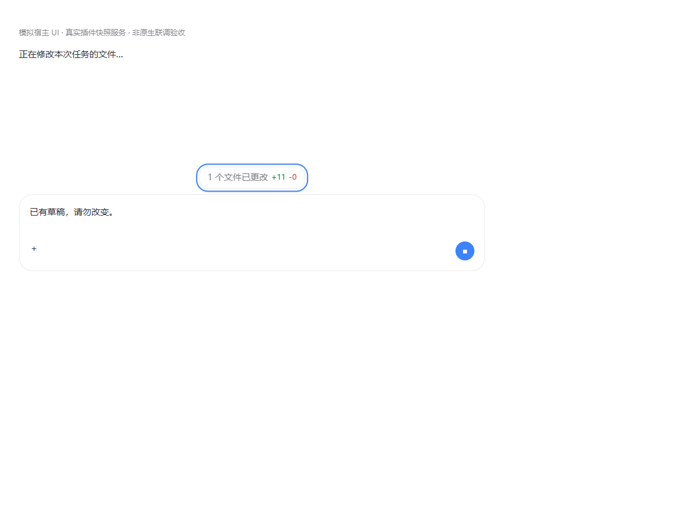

# v1.2.0：查看当前运行任务的文件变更

> 已通过最终 ESM、真实插件快照服务和浏览器自动化验收。宿主界面是模拟；本机 PI-Desktop 0.18.0 仅做安装资源只读核对，未自动安装、批准权限或执行原生点击验收。安装包与校验信息见项目根 `release-1.2.0.json`。

## 使用

安装 `plugin/dist/local.diff-view-1.2.0.piplug`，手动批准权限；开发目录用户可显式重新加载 `plugin/`。在新版 Agent 扩展加载后开始任务，使用 Write/Edit 修改普通文件。

- 当前对话正在运行且已有净变更时，输入框正上方出现“1 个文件已更改 +11 -0”。数字来自本次任务快照，不是整个仓库的 Git 状态。
- 点击胶囊直接打开右侧 **Diff view / 差异审查**，显示当前任务的已捕获差异。运行期间只读，无文件撤销、重新应用、暂存或取消暂存操作。
- 结束、停止、会话切换到无运行变更的对话或无净变化时，浮窗隐藏。任务结束后的原有文末卡片继续保留；点击文件可定位对应 diff。
- 新任务先清空旧统计。回到仍在执行的会话可重新读取该会话当前任务；不会显示已结束任务。没有当前用户消息 ID/有效时间、可靠采集边界或所属输入框时，不猜测归属。

## 边界

同一文件按任务首次 before → 当前已完成工具调用的 after 合并；重复编辑不重复计数，恢复原文后净零路径省略。约每秒请求一次统计，共享原有限速及后台作业桥接；慢任务或接口不可用时不显示未经验证的统计。

只有受支持文件工具明确触及的普通路径会被采集。Bash、子代理、外部进程和安装前变更不推测。二进制、大文件、缺失内容可能计入文件数，但行数只涵盖已验证文本；工作区外记录始终只读。现有凭据、私有目录、链接、设备路径等拒绝规则不变。

组件注册到公开 `composerControl` 的 left 位置；仅测量该插槽所属 `.composer-shell`，在插件自己的 portal 中绘制浮窗，不移动或修改宿主输入框。内部 store 只用于当前会话运行状态、可见用户消息元数据和插件页签跳转；不读其正文、历史或数据库。任务切换、结束和卸载使异步请求/点击的 epoch 失效；选择时再核验当前运行记录。

本机 0.18.0 的上述位置与状态字段已从安装资源只读确认，内部接口未来可能变化。结构或 React 身份不符时拒绝跳转；浮窗定位失败时隐藏。不会退回居中窗口、修改安装文件或自动发送聊天。

## 验收证据

| 批准的验收项 | 结果与证据 |
|---|---|
| 输入框上方单个胶囊，宽/窄、明/暗适配 | 已满足：`running.spec.ts` 四种布局验证居中、8px 间隔、输入框增高/变窄后跟随、无横向溢出；截图如下 |
| 真实净统计、更新和任务隔离 | 已满足：`task-capture.test.ts` 真实 Write/Edit hook、重复编辑/还原归零；浏览器连接 SnapshotStore/ReviewService 验证 +11 更新到 +2；其他会话、旧任务、新空任务和并行歧义不混入 |
| 完成/停止/切换隐藏，迟到结果不复活，文末承接 | 已满足：`running-changes.test.ts` epoch 竞态与点击失效；浏览器完成后胶囊消失、文末卡片出现，新任务不继承旧数字，停止/切换/迟到响应回归通过 |
| 点击右侧只读 diff，无额外列表/居中弹窗 | 已满足：最终 ESM 点击显示 `current.txt` 的真实 diff；后端拒绝运行记录的 revert/reapply/stage/unstage，原文件不变 |
| 文末回归、草稿不变、卸载重载清理 | 已满足：原 renderer 回归继续通过；浏览器检查草稿、单个胶囊、slot/订阅/style 清零和停止后台请求 |
| 全部命名检查 | 已满足：typecheck、build 通过；`npm test` 159 通过、1 跳过（Windows 不适用 POSIX FIFO）；`npm run test:e2e` 57/57 通过，使用本机 Chrome |
| 1.2.0 版本及安装包一致 | 版本元数据统一为 1.2.0；官方 PluginCheck/PluginPack 及安装包内容/哈希核对结果记录于 `release-1.2.0.json`，不手工生成归档 |

复跑：

```bash
npm run typecheck
npm test
npm run build
E2E_BROWSER='C:/Program Files/Google/Chrome/Application/chrome.exe' npm run test:e2e
```

其他机器替换浏览器路径或使用本机匹配的 Playwright Chromium。测试夹具、日志与 trace 放在 `PI_SCRATCH_DIR`，不放入用户项目或安装包。一次有限只读代码复核未发现具体缺陷；未执行循环复审。

### 截图

截图使用模拟宿主 UI 和真实插件快照服务；胶囊带蓝色轮廓是键盘焦点状态。

[宽屏明色](screenshots/running-pill-1100-light.png) · [宽屏暗色](screenshots/running-pill-1100-dark.png) · [360px 明色](screenshots/running-pill-360-light.png) · [360px 暗色](screenshots/running-pill-360-dark.png)



## 剩余验证

没有发布阻碍；原生宿主安装和点击体验未在本轮执行，不宣称浏览器模拟证明原生联调完成。加载新版插件后可在新的隔离任务核对胶囊、点击右侧 diff、任务结束后文末承接；运行中热重载会改变 generation，旧任务不补造统计。
