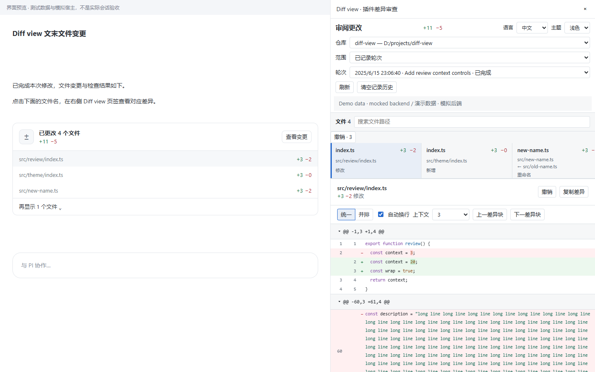

# 在最终回复末尾查看文件变更

> 当前是开发版，旧 v0.1.0 安装包未改动。自动化检查与浏览器预览不等于真实宿主点击验收；完成真实点击验证前不发布 v0.2.0。

## 使用方式

1. 保持开发插件启用。无需寻找输入框按钮，“Diff review”和“原生审阅预检”入口已删除。
2. 在**加载新版 Agent 扩展后开始的新任务**中，让 Agent 使用 Write/Edit 修改一个普通文件。运行中升级插件会导致 generation 变化，不能补造当时的 before 或最终回复关联；旧任务仍可在视图中只读查阅。
3. 任务结束后，最终回复末尾显示“已更改 N 个文件”、本次净增删行数及前三个文件；没有净变化时不显示空卡片。无法唯一匹配最终回复、用户任务边界不明或旧版记录也不伪造卡片。
4. 点击文件名：打开右侧工作面板的 **Diff view / 差异审查** 插件页签，选择该任务与该文件。点击“查看变更”选择该任务的首个文件；不是宿主原生审阅，也不是居中浮层。
5. 使用“再显示 N 个文件”展开。文件多时分批读取元数据，“收起文件”回到前三项，不重复读已加载页面。



## 文件来源与限制

- 汇总只来自本次用户任务的真实支持工具快照，不混入 Git 全部未提交变更。同一文件按首次 before → 最终 after 合并；改完又还原的净零路径被省略。
- 工作区外普通文件必须是 Write/Edit 明确触及的绝对路径，显示完整路径和“工作区外 · 只读”。不扫描磁盘、不推测 Bash 修改，不授予父目录读写权限；外部文件没有撤销、重做或暂存操作。
- 凭据、宿主/插件私有数据、依赖目录、UNC/设备/ADS 和链接祖先被拒绝。非文本、超限、缺失内容仅显示元数据，行数不冒充完整统计。
- Bash、自定义工具、子代理、失败或迟到事件会令归因不完整。卡片可显示已经可靠采集的路径，并解释遗漏；完整归因要求未满足时禁止恢复。
- v1 历史仍可只读审阅，但不重构用户边界、外部文件来源或文末卡片。

## 侧栏跳转与排错

宿主 0.17.0 没有公开的 renderer“打开插件页签”操作。按已授权方向，仅复用固定已核验构建中的 store `R`、插件页签工厂 `aO` 和 React 身份。只打开 `plugin:local.diff-view/review`，不读取聊天历史、不改消息、不操作原生审阅 DOM。三个固定宿主资源的哈希不匹配时拒绝自动打开，不回退到其他窗口。

选择仅保存在插件内存，最多 32 个会话、30 分钟有效。传给视图的是不含内容或文件路径的 UUID 令牌；首次经 `piViewOpen`、后续经 `view:open {path}` 传递。会话切换使旧会话令牌暂时无效，视图定期核对；重载、清历史或过期后需要重新点击卡片。

| 错误 | 处理方式 |
|---|---|
| `SIDEBAR_BUILD` / `SIDEBAR_CONTRACT` | 宿主构建/接口不匹配；停止自动跳转，提供错误供兼容修复，不更改安装文件 |
| `SIDEBAR_SESSION` | 回到卡片所属会话后重新点击 |
| `SIDEBAR_VIEW` | 检查本插件已启用且已授予 ui.view；权限由用户批准 |
| `NAVIGATION_EXPIRED` | 重新点击文末卡片，不猜测旧选择 |
| 快照或汇总不可用 | 读错误说明；不能用当前磁盘文件冒充历史 before/after |

侧栏复用原有 diff、评论、复制和受保护操作。独立视图桥接无法直接回填输入框，评论反馈由用户复制粘贴后手动发送；已有草稿保持不变。

## 开发验证

```bash
npm run typecheck
npm test
npm run build
E2E_BROWSER='C:/Users/32057/AppData/Local/ms-playwright/chromium-1228/chrome-win64/chrome.exe' CI=1 npm run test:e2e
```

使用官方 PluginCheck 校验 `plugin`。生产 renderer ESM 直接在宿主相同的三个 import-map 名称下测试，避免只验证 bundled-source 替身。浏览器流程使用已实现组件及明确标注的模拟宿主，覆盖卡片文件点击、展开/收起、会话保护和无输入区按钮；预览图不是已完成真实联调的证据。

2026-10-10 整合验证：

| 检查 | 实际结果 |
|---|---|
| TypeScript / 离线构建 | 通过；生产 renderer 无不支持的 JSX runtime 导入 |
| 后端 | 98 通过、1 个 Windows 不适用的 POSIX FIFO 测试跳过 |
| Chromium | 31/31 通过，含原有 diff/评论/操作回归 |
| 第 120 个文件 / 后续定位事件 | 真实构建 main 的捕获记录定位通过；浏览器 view:open 更新通过 |
| 官方 PluginCheck | 23 个文件，无错误和警告 |
| 开发宿主启动 | 注册表 dev / ready / enabled；真实 entry-loaded、bootstrap-ok 阶段已收到 |
| v0.1.0 安装包 | SHA-256 仍为 48d0bc50a9cde3b0275fc10b6d4056f44e6f0d86c174e1ec5c6a26c563029bfb |
| 真实文末卡片与侧栏点击 | 未验收；不宣称模拟测试证明此项通过 |


真实验收仍需：新版任务最终回复卡片出现；点击第二个文件，右侧打开本插件页签并显示该文件的 diff；关闭或切换会话后无串任务；工作区外记录只读。当前任务正在开发过程中，不能保证热重载前的旧采集会产生新版卡片。
