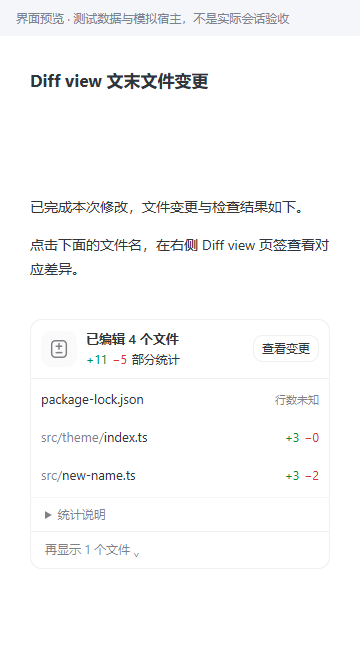

# Diff view 1.3.5 验证记录

尚未重载或安装到原生 PI-Desktop 窗口；浏览器验收使用真实本机 Chrome 和模拟宿主。旧历史若缺失完整快照，仍无法重建，不能用当前文件伪造历史。

## 本次修复

| 问题 | 修复 | 回归证据 |
| --- | --- | --- |
| 运行中侧边栏反复闪屏 | 后台更新保留文件节点和差异页，保持折叠状态；相同轮次内容复用审阅标识 | `tests/e2e/live-review.spec.ts` 监测节点始终挂载，验证慢请求不被打断 |
| 新修改延迟显示 | 审阅请求直接导入 inbox；“最近有修改轮次”持续同步，不因上一条记录完成而停止 | `tests/integration/modified-turns.test.ts`、`tests/e2e/live-review.spec.ts` |
| 不同文件的并发操作被误判冲突 | 明确文件工具只锁目标文件；Shell/Task 保留项目范围锁 | `tests/integration/expanded-capture.test.ts`、`tests/integration/snapshot.test.ts`；同文件冲突仍不可用 |
| 深目录扫描遗漏根目录锁文件 | 先读取本层文件再遍历子目录，保留原有扫描上限 | `tests/integration/expanded-capture.test.ts` 的根目录锁文件截断用例 |
| 历史恢复跳过完整的新采集快照 | 恢复标记只确认实际消费的版本，不确认尚未导入的 inbox 版本 | `tests/integration/host-history.test.ts` 的未导入新版本用例 |
| 卡片长说明、内部类型名及多余选择器 | 说明可折叠；未知行数独立对齐，不显示假零统计；轮次下拉仅在“已记录轮次”显示 | `tests/e2e/renderer.spec.ts`、`tests/e2e/round-consistency.spec.ts` |

## 已执行检查

- `npm run typecheck`：通过。
- `npm test`：28 个测试文件通过，240 项通过，1 项跳过（Windows 不适用的 POSIX FIFO 用例）。
- `E2E_BROWSER='C:/Program Files/Google/Chrome/Application/chrome.exe' npx playwright test`：84 项通过；模拟宿主，不等同原生运行验收。
- `npm run build`：通过，更新 `plugin/` 构建产物。
- `git diff --check`：通过。
- `package.json`、`package-lock.json`（含根包）、`plugin/package.json`、`plugin/manifest.json`：统一为 1.3.5。

期间有一次 Git 性能测试返回 128；未修改 Git 实现或放宽标准，独立重跑及最终全量运行均通过。

## 界面证据

[宽屏卡片截图](screenshots/unknown-card-1.3.5-900.png)。截图使用模拟数据；已实际查看窄屏截图。

## 使用与边界

安装新的 `local.diff-view-1.3.5.piplug` 或重载本地目录插件后再验收新任务。已运行中的旧 Agent 扩展不会自动替换。

同步采用 750 毫秒轻量轮询，等待工具结果快照及桥接响应；不承诺零延迟。不把尚未结束的 Shell/后台进程写入视为可证明的完整工具结果。同文件重叠、扫描超限、缺失快照、二进制及过大文本仍显示明确状态。
