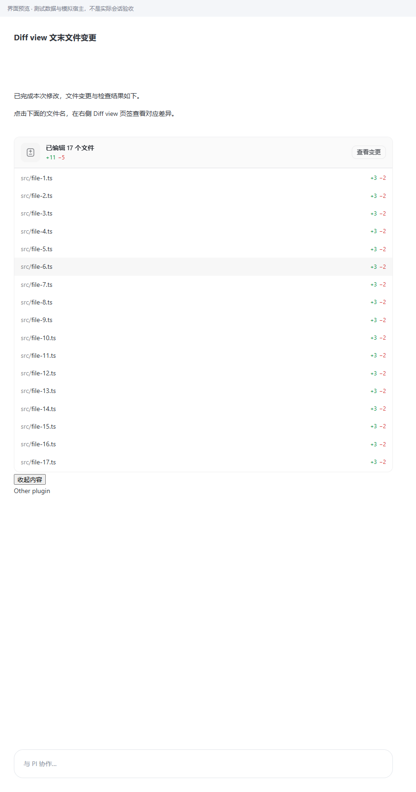
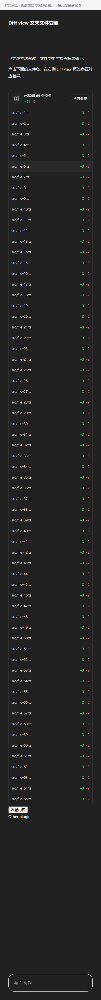

# 1.4.12：固定表头与按文件数量完整展开

> 本地开发目录已构建更新。需要在客户端插件页重载 Diff view，或安装 `plugin/dist/local.diff-view-1.4.12.piplug` 后生效。本次未执行客户端重载或真实会话点击验收；以下浏览器验证使用实际组件、生产构建与受控宿主夹具。

## 行为

- 表头吸顶，不随收起状态下的文件列表滚走；滚动展开后的页面时仍吸顶。
- 收起时保留宿主高度上限，文件列表可滚动；展开后取消内部限高及滚动区，按实际文件数量自然铺开。
- 超过首批 40 个文件时沿用有界分页，展开自动补齐后续文件；请求失败停止并保留人工重试。
- 保留宿主唯一展开/收起按钮、文件点击、查看变更和统计说明。
- 仅临时适配当前卡片最近的宿主视口，不调整其他插件或聊天正文；卸载时还原最新宿主样式，保留其他外部样式修改。

## 证据、原因与修改位置

| 证据 | 原因/发现 | 修改位置 |
|---|---|---|
| 只读核对本机 0.18.0 的 `index-BhBExKwo.js`：`injectStyle` 将普通规则置于 `@scope ([data-pi-plugin=…])` | 原来面向宿主外层视口的 CSS 无法越过插件作用域；表头选择器同样依赖外部祖先 | `src/renderer/summary-style.ts` |
| 改为真实 CSS 作用域的两项测试在旧实现均失败，滚动后表头偏离视口顶端 147px | 原测试全局注入样式，遗漏真实宿主限制 | `tests/e2e/renderer-harness.tsx`、`tests/e2e/renderer.spec.ts` |
| 宿主视口展开时仍设置 `max-height` 与 `overflow-y:auto` | 单纯展开宿主容器只是扩大内部滚动区 | `src/renderer/entry-extra-layout.ts`、`src/renderer/TurnChangeSummary.tsx` |
| 修复后 17/65 文件、4 文件短卡片、重复宿主限高写入与卸载还原断言通过 | 固定表头、完整铺开、自然高度及隔离性已由浏览器确认 | `tests/e2e/renderer.spec.ts` |

视口适配观察宿主的展开标记和 inline style，仅在变化时写入必要属性；仅在展开/收起切换时清零内部滚动位置，不因普通重渲染跳回顶部。卡片内部使用作用域内的 sticky 表头和不透明主题背景。没有全局 CSS 注入，也没有修改客户端安装文件。

## 已执行验证

```bash
npm run check
E2E_BROWSER='C:/Program Files/Google/Chrome/Application/chrome.exe' npm run test:e2e
git diff --check
```

- 类型检查、构建通过。
- 单元/集成：38 个文件，329 项通过，1 项 Windows 不适用的 POSIX FIFO 测试跳过。
- 全量浏览器：125 项通过；包含卡片分页/错误重试、文件打开、侧栏状态保持、连续差异更新、主题及本地 Git 操作。
- 专项：900px 浅色 17 文件与 360px 深色 65 文件完整展开；4 文件短卡片不强制固定高度；收起保持限高和可滚动；宿主重写限高后适配仍有效；卸载还原宿主样式；其他插件保留其 480px 滚动区。
- 两张完整展开截图已目检。插件校验、安装包字节数和 SHA-256 见项目根目录 `release-1.4.12.json`。

## 范围

本次只修改卡片布局、局部视口适配及测试夹具；保留既有未提交改动和 1.4.11 当前轮次修复。不新增权限或依赖，不修改宿主聊天数据、历史采集和 Git 实现，不执行真实项目暂存、提交或推送。客户端重载后的真实会话验收尚未执行。




