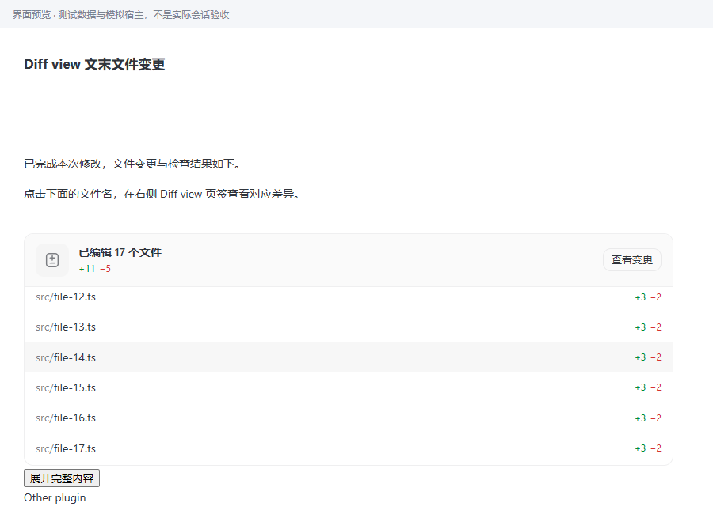
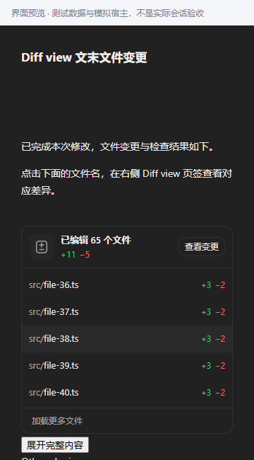
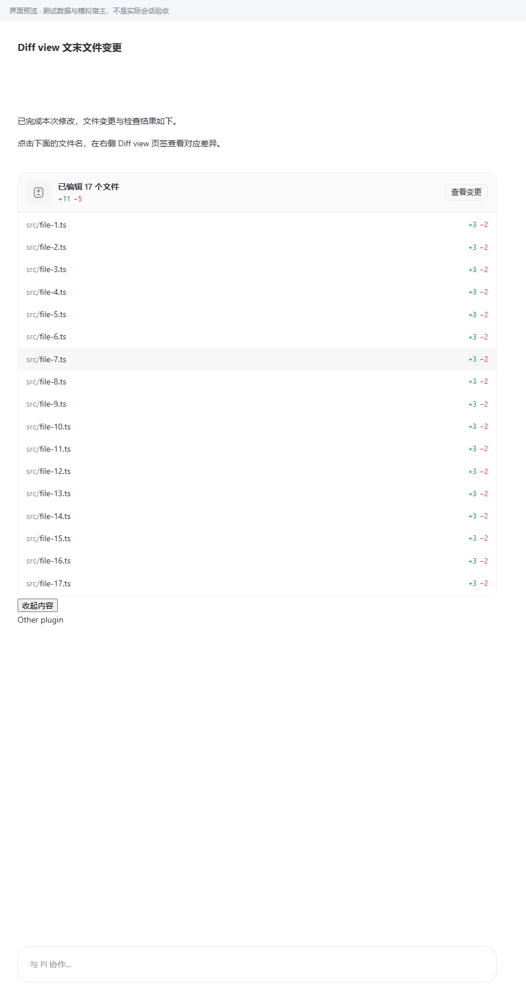
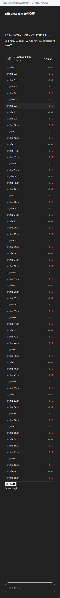

# 1.4.13：表头与目录独立，只有目录滚动

> 本地开发目录已构建。需在客户端插件页重载 Diff view，或安装 `plugin/dist/local.diff-view-1.4.13.piplug` 后生效。本次未重载客户端，未完成真实会话验收；浏览器证据使用实际组件、生产构建和受控宿主桥接，不能代替原生客户端验收。

## 修正行为

1. 表头与文件目录是兄弟节点，表头不是目录滚动容器的子元素；表头为 `position:static`，不使用 sticky。
2. 收起时外层视口为 `overflow:clip`，不可通过滚轮、焦点或 `scrollTop` 滚动；只有目录区域 `overflow-y:auto`。目录滚动条从表头下方开始，目录滚动前后表头坐标完全相同。
3. 目录包含文件、统计说明、分页与错误提示，支持滚轮及键盘；滚到底不会串滚到聊天页面。
4. 展开时目录及宿主视口恢复自然高度、可见溢出，全部文件依次展示，无内部滚动区。超过首批 40 个文件沿用有界续载，失败停止并允许重试。
5. 保留宿主唯一的展开／收起按钮。短目录全部可见时不显示多余展开按钮。
6. 展开后滚动整个聊天页面时，卡片和表头按正常文档流移动，不再吸顶。此次要求是目录内部滚动不移动表头，不改变聊天页面本身的滚动。

```text
卡片（不可滚动）
├─ 表头：统计与“查看变更”
└─ 文件目录：独立滚动区
   ├─ 文件列表
   ├─ 统计说明
   └─ 分页／错误提示
```

## 实现与证据

| 证据 | 发现／处理 | 位置 |
|---|---|---|
| 修复前两项新测试均失败：外层仍为 `overflow:auto` | 1.4.12 的 sticky 方案不满足结构分离要求 | `tests/e2e/renderer.spec.ts` |
| DOM 断言：表头不在目录内，计算定位为 `static` | 新增目录容器，表头成为其兄弟节点 | `src/renderer/TurnChangeSummary.tsx`、`src/renderer/summary-style.ts` |
| 实际鼠标滚轮、目录底部继续滚动、Home／ArrowDown 后表头坐标完全不变 | 外层不可滚动，目录独立滚动并阻止边界串滚 | `src/renderer/entry-extra-layout.ts`、`tests/e2e/renderer.spec.ts` |
| 测试夹具由 ResizeObserver 比较内层自然高度与视口高度，动态显示宿主按钮 | 在插件内部保留被折叠目录的高度差用于宿主测量；测量空间位于卡片之后、可见折叠区之外，展开时归零 | `src/renderer/entry-extra-layout.ts`、`tests/e2e/renderer.spec.ts` |
| 宿主限高重写、窗口变窄、分页、卸载及其他插件隔离断言通过 | 观察宿主状态与本卡片内容尺寸，按当前限高计算目录空间；卸载还原最新宿主样式 | `src/renderer/entry-extra-layout.ts` |

保留真实 `@scope ([data-pi-plugin="local.diff-view"])` 边界。没有全局 CSS 注入、不修改客户端安装文件，不重置无关样式更新时的目录滚动位置。

## 已执行检查

```bash
npm run check
E2E_BROWSER='C:/Program Files/Google/Chrome/Application/chrome.exe' npm run test:e2e -- tests/e2e/renderer.spec.ts -g 'host fold|pagination stops|scoped host expansion|only the directory'
E2E_BROWSER='C:/Program Files/Google/Chrome/Application/chrome.exe' npm run test:e2e
git diff --check
```

- 类型检查、构建通过。
- 单元／集成：38 个文件、329 项通过，1 项 Windows 不适用的 POSIX FIFO 测试跳过。
- 6 项专项浏览器测试通过，包含 900px 浅色 17 文件、360px 深色 65 文件、4 文件短卡片、实际滚轮、键盘、限高更新、尺寸变化、完整展开、分页失败重试与卸载还原。
- 全量浏览器回归：126 项通过、0 失败，覆盖文件打开、侧栏状态、轮次一致性、运行浮窗、主题及本地 Git 操作。
- 四张收起／展开截图已目检；元数据版本均为 1.4.13，差异格式检查通过。
- 安装包校验结果、字节数和 SHA-256 以项目根目录 `release-1.4.13.json` 为准。

## 使用与边界

本次保留既有未提交修改和 1.4.11 当前轮次修复，不修改文件打开、侧栏、历史采集或 Git 实现，不新增权限或依赖，不暂存、提交或推送项目修改。

客户端尚未重载：请在插件页重载本地目录，或安装新版包，再在真实会话的目录区域滚动检查。没有强制重启客户端或中断当前会话。

## 浏览器对照截图

截图均为模拟宿主，不是原生客户端验收。








