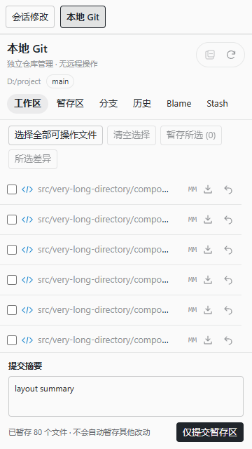
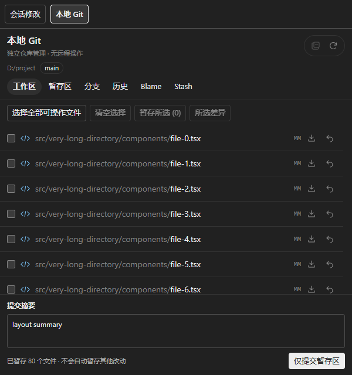

# 1.4.4 本地 Git 界面与提交区验证

本次只调整独立本地 Git 界面并增加显式单文件工作区撤销，不改变会话捕获、历史恢复、差异后台更新、评论、复制、浮窗或远程操作边界。

> 本地目录和安装包需要手动 reload / 安装后生效。本次未安装、未 reload，未在 PI-Desktop 原生宿主窗口执行最终验收。

## 使用方式

1. 打开“本地 Git”，在工作区勾选文件或点击行末暂存图标。
2. 点击文件路径可在该行下方展开差异，再次点击折叠；顶部叠页减号图标一键折叠。
3. 在底部输入必填提交摘要，点击“仅提交暂存区”并确认。只提交索引内容，不自动 add，不跳过 hooks。提交失败保留摘要，成功清空。
4. 文件与差异在中间区域独立滚动。底部摘要和提交按钮不随文件列表滚动，不会被长列表覆盖。分支、历史、Blame、Stash 不显示提交区。
5. 工作区行末撤销图标恢复暂存区版本；未跟踪文件会在确认后删除。取消暂存只改变索引，不撤销工作区内容。

撤销确认前读取普通文件及索引指纹，确认时重新校验。文件或索引已改变则拒绝覆盖；冲突、敏感路径、链接、非普通索引对象、大文件或没有可恢复索引版本的目标拒绝操作，需使用 Git CLI 核对。不会批量删除或执行 git clean。

## 设计范围

- 使用会话修改界面的系统字体、宿主主题 token、细分隔线、文件类型矢量图标和弱化目录／突出文件名的路径层级。
- 行首复选框；行末矢量暂存／取消暂存、撤销图标；保留状态字符和全部原有批量操作。
- 上下固定、中间 flex 滚动布局，不使用覆盖内容的浮动提交框。
- 图标包含 aria-label、title 和键盘焦点；浅色／深色均遵循宿主 token，尊重减少动画设置。
- 参考本地 `reference/pi-desktop-plugins/packages/pi.gitlens-0.2.7.piplug` 的 `renderCommitBox` 非空消息校验、重复提交禁用与成功／失败处理；保留本插件已有暂存区限定及确认机制，不引入 reference 的自动暂存或 amend 行为。

## 验证结果

| 检查 | 结果 |
|---|---|
| TypeScript | `npm run typecheck` 通过 |
| 单元／集成 | 35 个测试文件，297 项通过，1 项 Windows 不适用的 POSIX FIFO 测试跳过 |
| 浏览器全量 | 本机 Chrome，108 项通过 |
| 重点浏览器 | 17 项通过，包括新增 7 项 Git 布局／摘要测试 |
| 构建 | `npm run build` 通过；发布文档最终随构建复制 |

新增真实临时 Git 集成覆盖：部分暂存文件撤销不改变索引或 HEAD；恢复工作区删除；保留无关文件；确认后工作区或索引变化拒绝；仅删除明确确认的未跟踪文件；拒绝越界、敏感路径和批量删除；空摘要拒绝且索引不变。

浏览器布局覆盖 360／600／1100px、浅色／深色、80 个长路径文件：滚动前后提交区坐标一致，最后一行可见，滚动区止于提交框上方，无页面横向／纵向溢出；行内展开、再次折叠与顶部一键折叠；图标无文字；明确单文件暂存；撤销取消不执行；其他页面隐藏提交区；暂存区保留摘要；提交错误保留摘要，确认后发送去空白的消息。

既有真实 Git 浏览器测试仍验证：创建首次提交、只提交暂存区、不包含后续工作区和无关未跟踪改动、取消确认无写入、历史差异、脏工作区分支切换拒绝。全量回归包含会话隔离、侧栏稳定性、连续 diff 无感更新、评论与复制、卡片、主题、浮窗、分支、Blame、Stash 和 hooks。

## 截图

截图使用真实 Panel 源码与明确模拟桥接，布局夹具含 80 个文件，不代表宿主原生窗口截图。





## 复现命令

在项目根目录执行；`PI_SCRATCH_DIR` 使用会话临时目录，所有 Git 测试仓库都创建于其中。

```bash
npm run typecheck
npm test
npm run build
E2E_BROWSER='C:/Program Files/Google/Chrome/Application/chrome.exe' npx playwright test
```

`E2E_BROWSER` 可替换为本机浏览器绝对路径。发布包通过 PluginCheck 与 PluginPack 生成，不使用普通压缩 ZIP 替代。版本元数据与安装包文件名为 1.4.4；包哈希和校验结果见根目录 `release-1.4.4.json`。
