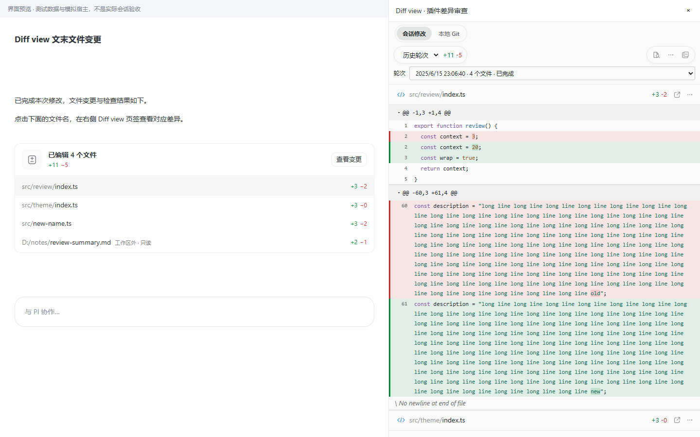
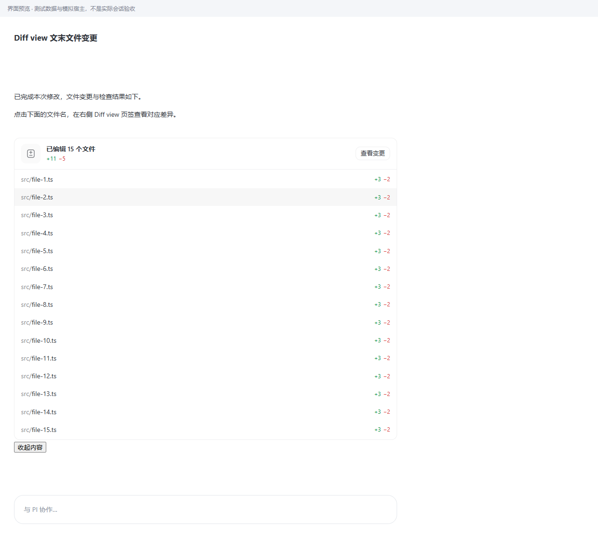

# 1.4.9：统一导航与单层卡片折叠

> 更新后手动 reload 插件，或安装 `plugin/dist/local.diff-view-1.4.9.piplug`。未自动安装、授权或修改客户端代码。

## 控件来源与修复

| 问题与证据 | 修复路径 | 保持不变 |
| --- | --- | --- |
| 顶部两个矩形按钮与内容区胶囊式工具栏割裂 | `src/view/index.tsx`、`theme.css`：统一主题、系统字体、12px 水平对齐和紧凑分段导航，移除独立强分隔线 | 切换逻辑、Git 项目选择、两个页面常驻和状态保留 |
| 插件 `TurnChangeSummary.tsx` 含“再显示／收起文件”；客户端的回复容器另有“展开完整内容／收起内容”，形成嵌套折叠 | 删除插件文件折叠状态与按钮，保留客户端的唯一折叠入口；不注入覆盖客户端消息控件的全局 CSS | `entryExtra` 插槽、回复正文折叠、文件路径点击、查看完整变更 |
| 旧摘要只含前三项，直接删除按钮会丢失其余文件入口 | 首批摘要最多 40 个文件，并预留桥接封装预算；升级卡片及 feed 缓存标识，旧三项预览重新生成 | 完整轮次统计、只读卡片、历史内容证据、会话隔离 |
| 大列表仍须满足桥接大小限制 | “加载更多文件”仅追加有界元数据页，不再折叠文件；长元数据会减少首批数量 | 分页、错误重试、已加载页面复用、文件顺序 |

## 已执行专项验证

- 类型检查通过；摘要与历史专项 21 项测试通过。
- 卡片及既有主题用例 29 项通过；新增导航用例因浏览器将 flex 子项的 `inline-flex` 计算为 `flex`，修正测试断言后 6 项全部通过。
- 新回归覆盖：旧三项缓存升级到 15 个文件；大列表分页不超桥接预算且顺序完整；普通卡片无第二层折叠；模拟客户端一次展开看到第 15 个文件；分页失败可重试、刷新不收回已加载文件。
- 360／600／1100px、浅色／深色导航、键盘焦点和 Enter 切换检查通过。
- 目检下面两张截图，确认导航和内容区协调、15 文件卡片只有客户端的一次收起操作。截图使用测试数据与模拟宿主，不代表真实客户端点击验收。

## 全量验证

- `npm run typecheck`、`npm run build` 通过。
- `npm test`：37 个测试文件，324 项通过、1 项跳过（Windows 不适用的 POSIX FIFO 用例）。
- 本机 Chrome `npm run test:e2e`：122 项全部通过，包含生产 renderer 导入、Git 操作、文件打开、会话隔离、状态保留和静默刷新。
- 自动化使用受控测试数据和模拟宿主桥接；没有声称已执行真实客户端 reload 或点击验收。





## 复现命令

```bash
npm run typecheck
npm test
npm run build
E2E_BROWSER='C:/Program Files/Google/Chrome/Application/chrome.exe' npm run test:e2e
```

## 边界

仅修改插件导航和卡片展示及其摘要分页，不修改客户端、不新增权限或依赖、不写宿主历史，不执行真实项目的 Git 暂存／提交／推送。超多文件的“加载更多文件”是分页而非第二层折叠；“查看变更”仍能进入完整轮次。实际客户端更新后的显示仍需 reload 后观察。
